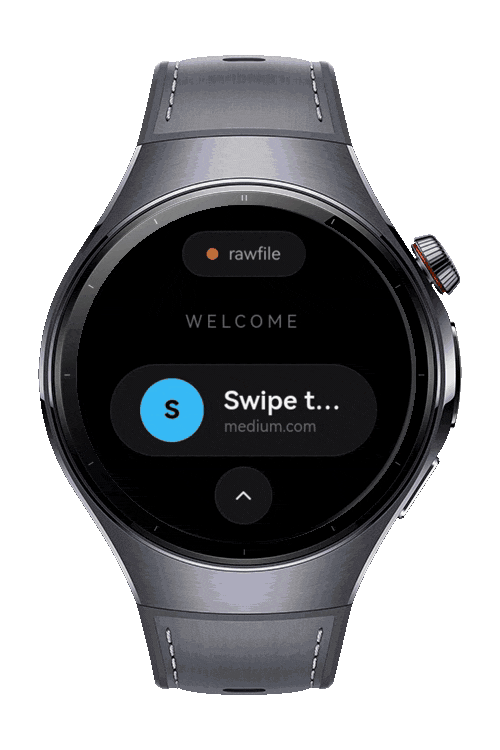
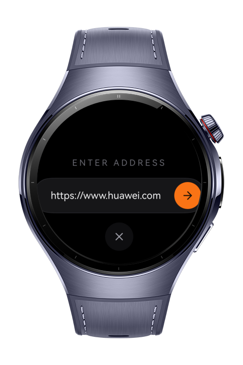
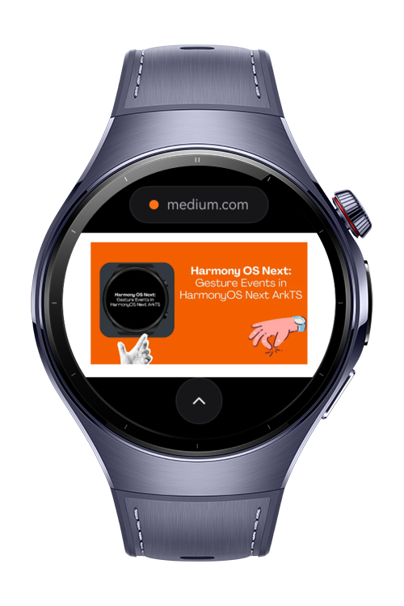

> **Note:** To access all shared projects, get information about environment setup, and view other guides, please visit [Explore-In-HMOS-Wearable Index](https://github.com/Explore-In-HMOS-Wearable/hmos-index).

# Mini Browser

**Mini Browser** is a smartwatch mini web browser with a built-in reader mode, designed to make reading articles on the wrist quick and comfortable. The app opens on a curated home page, lets users navigate to any address, and then strips a page down to its essential text so it can be read at a glance, even while on the move.

On the main screen, the current site is shown as a host pill at the top; tapping it opens a full-screen search where the user types an address  with quick access to recently saved sites  and confirms with Go to load it in the embedded web view. A collapsible action bar at the bottom holds the core browsing actions: Back, Forward and Reload for navigation, plus Reader and Save, while a More (•••) button reveals Reading List, History and Settings.

Tapping the **Reader** button extracts the current page's readable content  title, byline and paragraphs  by running a lightweight extraction script in the page, then presents it in a clean, distraction-free reading view optimized for the watch.

The **Save** action stores the current article  including its full extracted text  to a persistent **Reading List**, so it can be reopened later straight in Reader mode, even offline; such items are marked with an offline badge, and any entry can be removed with swipe-to-delete. The **History** view lists the session's back/forward entries and lets the user jump directly to any of them. The **Settings** (Data & Privacy) screen offers one-tap controls to clear cookies, DOM storage, browsing history, cache and the web database.

With its arc-aware lists and smartwatch-optimized layout, Mini Browser keeps full browsing and focused reading within easy reach on the wrist.

# Preview

<div>
    
    
    
</div>

# Use Cases

1. The user opens Mini Browser on their smartwatch and sees the home page with suggested links.

2. Taps the host pill to open search, types a URL (or picks a recently saved site) and taps Go to load it in the web view.

3. Expands the bottom action bar and uses the Back, Forward and Reload buttons to navigate while browsing.

4. Taps the **Reader** button to open a clean, text-only view of the current article.

5. Taps **Save** to add the article  with its full text  to the Reading List for later, offline reading.

6. Opens the **More** (•••) menu to reach **History** and revisit a previously viewed page from the session.

7. Opens **Reading List**, where saved articles open straight in Reader mode (offline), or swipes an entry to delete it.

8. Opens **Settings** to clear cookies, storage, history, cache or the web database.

# Technology

## Stack

**Languages**: ArkTS, ArkUI  
**Frameworks**: HarmonyOS SDK 6.0.1(21)  
**Tools**: DevEco Studio
**Libraries/Kits**:

- @kit.ArkWeb
- @kit.ArkUI
- @kit.ArkData
- @kit.AbilityKit
- @kit.BasicServicesKit
- @kit.PerformanceAnalysisKit

# Directory Structure

```
│   module.json5
│
├───ets
│   ├───common
│   │       Avatar.ets
│   │       ReaderExtractor.ets
│   │       WebDataManager.ets
│   │
│   ├───entryability
│   │       EntryAbility.ets
│   │
│   ├───entrybackupability
│   │       EntryBackupAbility.ets
│   │
│   ├───model
│   │       BrowserSession.ets
│   │       ReaderContent.ets
│   │       ReadingListStore.ets
│   │       Types.ets
│   │
│   ├───pages
│   │       Index.ets
│   │
│   └───views
│           HistoryPage.ets
│           ReaderPage.ets
│           ReadingListPage.ets
│           SettingsPage.ets
│
└───resources
    ├───base
    │   ├───element
    │   │       color.json
    │   │       float.json
    │   │       string.json
    │   │
    │   ├───media
    │   │       background.png
    │   │       foreground.png
    │   │       ic_back.svg
    │   │       ic_book_accent.svg
    │   │       ic_book_dim.svg
    │   │       ic_bookmark.svg
    │   │       ic_cache.svg
    │   │       ic_chevron_down.svg
    │   │       ic_chevron_up.svg
    │   │       ic_clock_accent.svg
    │   │       ic_clock_dim.svg
    │   │       ic_close.svg
    │   │       ic_cookie.svg
    │   │       ic_database.svg
    │   │       ic_forward.svg
    │   │       ic_gear_accent.svg
    │   │       ic_go.svg
    │   │       ic_history_red.svg
    │   │       ic_more.svg
    │   │       ic_offline.svg
    │   │       ic_reader.svg
    │   │       ic_reload.svg
    │   │       ic_save_dark.svg
    │   │       ic_storage.svg
    │   │       ic_trash_white.svg
    │   │       layered_image.json
    │   │       startIcon.png
    │   │
    │   └───profile
    │           backup_config.json
    │           main_pages.json
    │
    ├───dark
    │   └───element
    │           color.json
    │
    └───rawfile
            home.html

```

# Constraints and Restrictions

## Supported Device

- Huawei Watch 5

# License

**Mini Browser** is distributed under the terms of the **MIT License**
See the [LICENSE](LICENSE) for more information.
